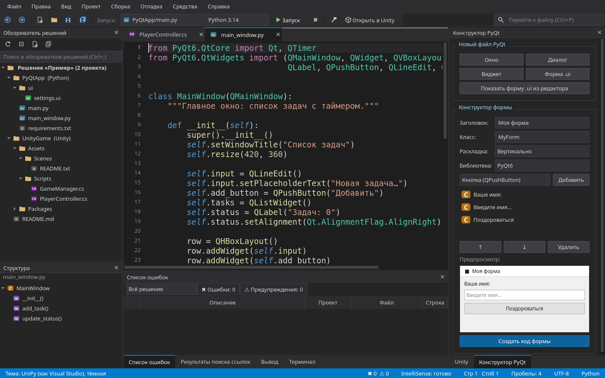
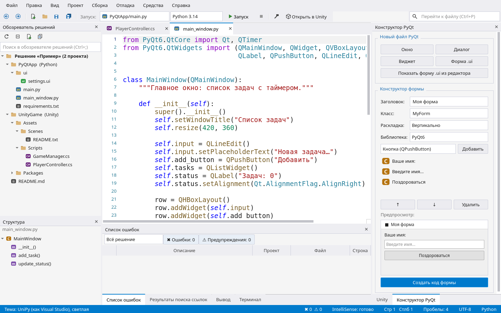

# UniPy Studio

A code editor in the spirit of Visual Studio for **Unity (C#)** and **Python / PyQt6** on Linux.
Written in Python + PyQt6.

*Русское описание — ниже.*



## Features

- **C# for Unity through Roslyn** — the same engine as IntelliSense in Visual Studio. Reads the
  `.sln` / `.csproj` files Unity generates: completion, parameter info, hover docs, errors,
  Ctrl+click / F12 into your code and into Unity classes (`MonoBehaviour → Behaviour → Component → Object`).
- **Python through pyright** (the core of Pylance) with checks tuned for PyQt6: red only for
  near-certain bugs (unknown names, missing attributes on your own class), no "may be None" noise.
  Falls back to jedi when pyright is not installed.
- **Visual Studio shortcuts**: F12 / Ctrl+click, Ctrl+− / Ctrl+Shift+− (back / forward),
  Shift+F12 (find all references), Ctrl+R, Ctrl+R / F2 (rename), Ctrl+Space, Ctrl+Shift+Space, F5.
- **Solution Explorer shows code only**, like Visual Studio; "Show all files" toggles the full view.
- **Keeps file encodings** (UTF-8, UTF-8 with BOM, Windows-1251) and line endings byte for byte.
- **Themes**: own dark and light themes in the Visual Studio style; light/dark follows KDE or is
  chosen manually. With [equestria-qt-kit](https://github.com/Lucia7Lunadottir) 1.2+ — Equestria OS
  character themes as well.
- **Analyzer updates only on request** (Help → Analyzer updates): the new version is self-tested
  and rolled back automatically if it does not work.



## Requirements

- Python 3.9+, PyQt6, jedi (`python`, `python-pyqt6`, `python-jedi` on Arch)
- Optional, for C#: .NET SDK and the Roslyn language server
  `dotnet tool install --global roslyn-language-server --prerelease`
- Optional, for Python errors: Node.js and pyright
  `npm install -g --prefix ~/.local pyright`
- Optional: `equestria-qt-kit` 1.2+ for character themes

Both analyzers are official Microsoft packages (NuGet / npm). The editor finds them in
`~/.dotnet/tools` and `~/.local/bin`.

## Run

```sh
./start.sh                          # or: python3 main.py
./start.sh "/path/to/Unity project" # open a folder or a file right away
```

For a Unity project, Unity must have generated the `.sln` / `.csproj` files
(the Visual Studio or Rider package in Packages — present in new projects by default).

## Arch Linux package

```sh
cd packaging && makepkg -fc
sudo pacman -U unipy-studio-*.pkg.tar.zst
```

---

# UniPy Studio (по-русски)

Редактор кода в духе Visual Studio для **Unity (C#)** и **Python / PyQt6** на Linux.

- **C# для Unity через Roslyn** — тот же движок, что IntelliSense в Visual Studio: подсказки,
  параметры, справка, ошибки, Ctrl+клик / F12 в свой код и в классы Unity.
- **Python через pyright** с проверками под PyQt6: красным — только почти наверняка ошибки.
  Без pyright — подсказки jedi.
- **Клавиши Visual Studio**: F12 / Ctrl+клик, Ctrl+− / Ctrl+Shift+− (назад / вперёд),
  Shift+F12 (все ссылки), Ctrl+R, Ctrl+R / F2 (переименовать).
- **Обозреватель решений показывает только код**, как Visual Studio; «Показать все файлы» — всё.
- **Кодировки файлов сохраняются** (UTF-8, UTF-8 с BOM, Windows-1251) и переводы строк — байт в байт.
- **Темы**: свои тёмная и светлая в стиле Visual Studio, светлая/тёмная — как в KDE или вручную;
  с `equestria-qt-kit` 1.2+ — ещё и темы персонажей Equestria OS.
- **Анализаторы обновляются только по кнопке** («Справка → Обновления анализаторов»), с самопроверкой
  и автоматическим откатом.

Запуск: `./start.sh` или `python3 main.py`. Установка анализаторов — команды в разделе
«Requirements» выше.
